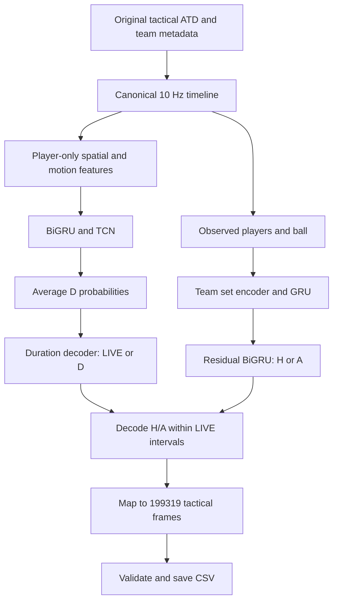

# Final Solution

**Team: slonyariki**

A reproducible solution for [More than a Hack 2027](https://github.com/metrica-sports/more-than-a-hack-2027), the frame-by-frame football possession challenge by Metrica Sports and FC Barcelona.

## What does this project do?

For each frame of the Barcelona–Athletic Club tactical recording, the system answers one question: **who has possession, or is the ball out of play?**

| Output | Meaning |
|---|---|
| `H` | Barcelona has possession while play is live. |
| `A` | Athletic Club has possession while play is live. |
| `D` | The ball is not in play. This does not assign ownership of the restart. |
| `X` | No answer outside the supplied first- and second-half timing blocks. |

The result is a CSV with **199,319 rows**, one for every video frame, numbered `0` through `199318`. The system uses the **provided tactical tracking coordinates**, rather than processing the video pixels itself.

You do not need to train a model to reproduce the submission. The repository includes the frozen neural-network weights, preprocessing parameters and temporal decoders. A cache-free CPU run from the original ATD files has reproduced the frozen prediction byte-for-byte.

## Start here

- **Run the solution:** follow [Quick start](#quick-start).
- **Understand the approach:** read [How it works](#how-it-works).
- **Interpret the scores:** read [RESULTS.md](RESULTS.md).
- **Read the submission document:** [PDF](slonyariki.pdf) or [Markdown](slonyariki.md).
- **Check training sources and splits:** [TRAINING_DATA.md](TRAINING_DATA.md) and [DATA_SOURCES.json](DATA_SOURCES.json).

## Quick start

### 1. Create the Python environment

The reference environment is **Python 3.13.9 on macOS, running PyTorch on CPU**. These commands assume a macOS or Linux shell and are run from the repository root:

```bash
python3.13 -m venv .venv
source .venv/bin/activate
python -m pip install -r requirements.txt
python -m ipykernel install --user --name slonyariki --display-name "slonyariki"
```

The pinned packages are for inference and notebook execution. No training-data download, API key, GPU or cloud service is required. We have verified the generated labels in the reference environment; another platform must pass the same output-checksum test.

### 2. Provide the authorised competition files

Obtain the competition data through the organisers. This repository does **not** redistribute it. Only these two files are needed:

```text
data/tactical/
├── BAR-ATH_tactical_atd.txt
└── BAR-ATH_tactical_atd.xml
```

The TXT file contains the tracking observations. The XML file assigns tracking slots to teams. Slots are not persistent player IDs.

You can keep the files elsewhere instead of copying them:

```bash
export MTAH_DATA_DIR="/absolute/path/to/the/tactical/folder"
```

This directory must contain both files named above. The program checks their SHA-256 hashes before using them. Broadcast video, tactical video, homography files, audio, Smart Tagging and possession-reference files are not required for inference.

### 3. Generate the submission

Run the notebook through Jupyter:

```bash
python -m nbconvert \
  --to notebook --execute sol/final/inference.ipynb \
  --ExecutePreprocessor.kernel_name=slonyariki \
  --ExecutePreprocessor.timeout=-1 \
  --output executed_inference.ipynb --output-dir local_review
```

Alternatively, open [sol/final/inference.ipynb](sol/final/inference.ipynb) in your notebook editor, select the `slonyariki` kernel and run all cells.

The final cell writes:

```text
local_review/submission/slonyariki.csv
local_review/submission/run_manifest.json
```

It verifies the submission format with the official validation function and then checks that the **entire CSV is byte-for-byte identical to the frozen final prediction**. A mismatch stops the run with an error. It never loads a reference CSV to produce or repair the predictions.

Optional caches are created under `local_review/cache/`. They are tied to input hashes, model files, code, configuration and dependency versions. A clean checkout can rebuild them from the two original files. To explicitly bypass them:

```bash
MTAH_USE_CACHE=0 python -m nbconvert \
  --to notebook --execute sol/final/inference.ipynb \
  --ExecutePreprocessor.kernel_name=slonyariki \
  --ExecutePreprocessor.timeout=-1 \
  --output cold_run.ipynb --output-dir local_review
```

## How it works

The system separates two decisions that need different evidence:

1. **Is play live?** Player formations and movement are used to detect stoppages.
2. **If play is live, which team has possession?** Player and observed-ball geometry are used to choose H or A.



### Detecting stoppages

The D branch deliberately excludes the ball. In the external data, ball coordinates can remain fixed during stoppages and later jump. A model could exploit this provider-specific behaviour instead of learning a signal that transfers to the competition tracking.

Each 10 Hz frame has 140 player-only features: spatial quartiles, player-observation counts, set-based motion summaries and temporal averages. Set-based motion compares player groups without requiring stable player identities.

Two frozen networks process these features:

- **BiGRU:** reads temporal context in both directions;
- **TCN:** uses dilated convolutions to capture movement at different time scales.

Their D probabilities are averaged. A duration decoder then selects a coherent LIVE/D sequence using duration statistics fitted on external training matches. It can use future frames: this is an **offline**, not a streaming, solution.

### Choosing the team

A frozen encoder groups the observed players by team. It combines their coordinates with observed-ball information, pools player features within each team, and produces a compact temporal representation. A second, bidirectional GRU learns a correction to the encoder's H/A probabilities.

A two-state decoder discourages unsupported rapid H/A switching within each predicted LIVE interval. D breaks the LIVE interval. Missing ball observations are masked rather than treated as proof of a stoppage.

### Returning to the video timeline

The input ATD uses one-based record IDs; the submission uses zero-based video frames. The adapter explicitly handles this difference. Predictions are computed at 10 Hz and held onto the 25 Hz tactical timeline within the supplied half blocks. No labels are interpolated. Frames outside those blocks are `X`.

## External validation at a glance

The released model is the externally selected **D ensemble + H/A BiGRU**, with no broadcast or audio correction.

| External validation | Metric | Result |
|---|---|---:|
| Sportec: two matches, equal mean across matches and clean/noisy views | D-interval F1 | 0.8369 |
| SkillCorner: four matches, original retained views | H/A-only clipped spellF1 | 0.8723 |
| Same SkillCorner validation | H/A-only macroF1 | 0.9588 |

**These metrics evaluate different components and do not form a combined H/A/D score.** Validation was used for checkpoint and decoder selection and reused during development. See [RESULTS.md](RESULTS.md) for the H/A comparison, per-match results, class metrics and interpretation.

## Repository map

```text
README.md                     Overview and execution instructions
slonyariki.pdf                Three-page technical document for the submission form
slonyariki.md                 Editable Markdown version of the report
assets/architecture.svg       Vector diagram used by the report
RESULTS.md                    Carefully scoped result tables
TRAINING_DATA.md               Sources, target construction, splits and amounts
DATA_SOURCES.json              Pinned public-source revisions and checksums
requirements.txt              Pinned inference dependencies
sol/final/
    config.json               Frozen model, timing and reproduction contract
    features.ipynb            Tactical adapter and player-only features
    models.ipynb              PyTorch networks, windowing and decoders
    inference.ipynb           End-to-end submission generation
    weights/                  Exported weights, scalers, duration model and hashes
vendor/                       Unmodified official scoring implementation and notice
local_review/                 Ignored outputs, caches and executed notebooks
```

The repository contains the final inference implementation and trained artifacts. It does not contain every exploratory experiment or a one-command retraining pipeline. Training choices, data revisions and selected checkpoints are documented so the origin of every released model is clear.

## Troubleshooting

- **Missing input files:** set `MTAH_DATA_DIR` to the folder containing both tactical ATD files, not its parent or the broadcast folder.
- **Input checksum mismatch:** check that the original files were fully downloaded and have not been edited or re-exported.
- **Missing kernel:** run the `ipykernel install` command from the activated environment, then select `slonyariki`.
- **Cache mismatch:** delete only the reported directory under `local_review/cache/`, then rerun. Caches are optional.
- **Final CSV checksum mismatch:** use the pinned environment and unchanged configuration. Do not disable the check or manually edit the CSV; the mismatch means the frozen result has not been reproduced.

## Attribution

Training used [SkillCorner Open Data](https://github.com/SkillCorner/opendata) and [Sportec/IDSSE data distributed by PySport](https://huggingface.co/datasets/pysport/idsse-data). We thank SkillCorner, PySport, Sportec Solutions and the DFL. The official metric implementation is from [Metrica Sports](https://github.com/metrica-sports/more-than-a-hack-2027). See [THIRD_PARTY_NOTICES.md](THIRD_PARTY_NOTICES.md).

Competition assets, frame-level predictions, caches and executed notebook outputs remain local. Only code, final aggregate results and trained model artifacts belong in the public repository.
