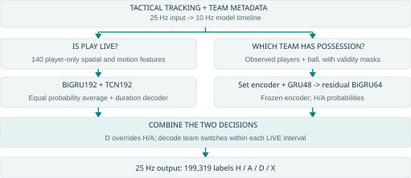

# Final Solution

**Team:** slonyariki  |  **Challenge:** More than a Hack 2027 (Metrica Sports / FC Barcelona)

Our solution makes two decisions: first, whether play is live or stopped; second, which team has possession during live play. Temporal decoders turn these predictions into possession intervals and one label for every tactical-video frame.

| External validation metric | Value |
|---|---:|
| Sportec: D-interval F1 | **0.8369** |
| SkillCorner: H/A spellF1 | **0.8723** |
| SkillCorner: H/A macroF1 | **0.9588** |

External validation: two Sportec matches with clean/noisy views; four SkillCorner matches with original views. These component metrics measure different tasks and are not a combined H/A/D score.

### How the released system works



D/LIVE uses no ball features: external ball tracks can freeze during stoppages and later jump, creating a provider-specific shortcut. The H/A branch uses the observed ball with validity masks.

### H/A models on the same SkillCorner validation split

| Model | H/A spellF1 | H/A macroF1 |
|---|---|---|
| Frozen encoder + decoder | 0.8448 | 0.9453 |
| Encoder + linear residual head | 0.8428 | 0.9453 |
| Encoder + residual TCN | 0.8609 | 0.9516 |
| Encoder + residual BiGRU (released) | 0.8723 | 0.9588 |

All variants reuse the same frozen encoder and validation matches, with switch cost 6.0. The residual BiGRU is selected by H/A-only spellF1. These validation data were used for model selection; the scores are not independent test estimates.

## Two branches, different evidence

### Training labels come from other matches

**Sportec / IDSSE (D/LIVE):** seven matches distributed by PySport, collected by Sportec Solutions and owned by the DFL. Provided `BallStatus` is the target: 0 = D, 1 = LIVE; unknown values are masked. Status, possession and event annotations never enter the features.

**SkillCorner (H/A):** twenty matches with provider-generated possession and phase targets. We retain a team label only where possession agrees with a live phase. Ambiguous, conflicting and phase-boundary targets are masked. Missing targets are not D. Inputs retain detected observations; extrapolated coordinates are masked.

| Split | Sportec: matches / labels | SkillCorner: matches / labels |
|---|---|---|
| Training | 4 / 227,325 | 12 / 305,354 |
| Validation | 2 / 117,112 | 4 / 98,290 |
| Test | 1 / 56,624 | 4 / 103,042 |

Counts are unique retained labelled frames at 10 Hz, before augmentation. Training amounts: 6.315 hours for D/LIVE and 8.482 hours for H/A. All splits are by match. We added no manual annotations. Exact IDs, source revisions and hashes are in TRAINING_DATA.md and DATA_SOURCES.json.

### 1. Detecting D/LIVE from players

Per-frame team position quartiles, observation counts and set-based motion summaries form 20 features. Adding past/future averages over 1, 3 and 10 seconds gives 140 dimensions. This representation does not require stable player identities. Scaling is fitted on training data.

A two-layer **BiGRU192** and an eight-block **TCN192** each process 70 seconds and emit the central 10 seconds. The TCN uses kernel 3 and dilations 1-128. Clean and corrupted tracking views include contiguous observation loss and geometric noise. Training adds boundary and in-state stability losses to state cross-entropy.

We average D probabilities 50:50. A duration-aware Viterbi decoder uses complete external training intervals, 0.5-second bins and frozen duration weight **0.25**. Checkpoints use mean validation D-interval F1 across matches and clean/noisy views.

### 2. Choosing H/A from players and the observed ball

A shared player MLP and team-wise masked mean/max pooling feed a **GRU48** encoder. Encoder training uses ball occlusion, player dropout, reflections and team swaps. Its frozen embeddings and H/A probabilities feed a one-layer **BiGRU64**, which learns a residual correction to the encoder log probabilities using five seconds of context on each side.

The residual head uses the original SkillCorner views and a training-fitted scaler. Within each predicted LIVE interval, a two-state Viterbi decoder applies switch cost **6.0**, selected on external H/A validation. D ends the LIVE interval and overrides the team prediction.

| Released component | Training / selection |
|---|---|
| D BiGRU + TCN | AdamW; LR 0.0007; batch 16; max 50 epochs; selected epochs 8 / 16 |
| H/A encoder | External validation; selected epoch 3 of 8 |
| H/A residual BiGRU | AdamW; LR 0.001; batch 32; max 20 epochs; selected epoch 19 |

D models and the H/A residual head use dropout 0.15 and weight decay 0.001. Decoder parameters and checkpoints were selected using external validation matches.

## Validation and reproduction

### H/A validation across four matches

| SkillCorner match | H/A-only spellF1 |
|---|---|
| 1925299 | 0.8913 |
| 2016236 | 0.8499 |
| 2011166 | 0.8785 |
| 2013725 | 0.8702 |

The aggregate H/A validation spellF1 is 0.8723 over labelled LIVE spans; unknown spans split intervals. Sportec D-interval F1 is 0.8369, averaged equally over its two validation matches and clean/noisy views. It matches stoppage intervals, while H/A spellF1 matches possession intervals. Validation selects checkpoints and decoder settings; these splits were reused during development.

### Output and possession rules

Inference uses `BAR-ATH_tactical_atd.txt` and its XML team metadata. The adapter converts one-based ATD records to zero-based video frames, converts coordinates to metres, masks missing observations, and resamples to 10 Hz.

H means Barcelona, A Athletic Club, and D a stoppage without restart ownership. Labels are held onto the 25 Hz timeline within the organiser-supplied half blocks; other frames are X. Loose or contested balls have no extra state: temporal evidence discourages rapid H/A switching, with no hard minimum possession duration.

### Scope and limitations

Smart Tagging, camera geometry, broadcast descriptors and whistle heuristics were explored but excluded: audio confused crowd noise with whistles; broadcast cues lacked external calibration. Later H/A fine-tuning and joint decoding did not qualify to replace the released system.

Released networks, preprocessing and duration models use external training data; model selection uses external validation. Sparse tracking, contested possession and provider differences remain limitations. Clubs can recur across SkillCorner splits, and the small, reused validation sets limit generalisation claims. Future context makes this an offline system. Further work would focus on externally labelled possession transitions and paired broadcast/audio validation.

### Reproduce the exact submission

Use the pinned environment in `README.md`, supply the two authorised ATD files, and run `sol/final/inference.ipynb`. Frozen weights, scalers and decoders are included; no retraining or training-data download is needed.

```bash
python -m nbconvert --to notebook --execute sol/final/inference.ipynb \
  --ExecutePreprocessor.kernel_name=slonyariki \
  --ExecutePreprocessor.timeout=-1 \
  --output executed_inference.ipynb --output-dir local_review
```

The notebook writes `local_review/submission/slonyariki.csv`, checks all 199,319 rows with the official validator, and enforces the SHA-256 in `config.json`. A cache-free CPU run from the original files reproduced the frozen CSV byte-for-byte. The package reproduces inference, not bit-identical retraining.

Sources: [Sportec / IDSSE via PySport](https://huggingface.co/datasets/pysport/idsse-data); [SkillCorner Open Data](https://github.com/SkillCorner/opendata). Full source attribution, match splits, model provenance and reproduction settings are documented in the repository.
