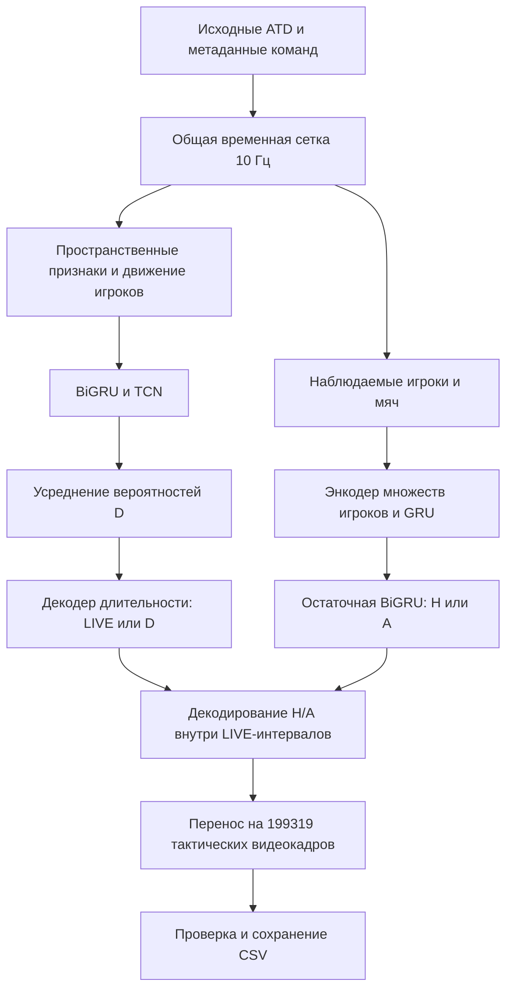

# Final Solution

**Команда: slonyariki**

Воспроизводимое решение для [More than a Hack 2027](https://github.com/metrica-sports/more-than-a-hack-2027) - соревнования Metrica Sports и FC Barcelona по определению владения мячом на каждом кадре футбольного матча.

Это русская версия основной документации. [English version](../README.md). [Технический отчёт на русском языке](slonyariki.pdf).

## Что делает проект?

Для каждого кадра тактической записи матча Barcelona - Athletic Club система отвечает на вопрос: **какая команда владеет мячом или мяч находится вне игры?**

| Метка | Значение |
|---|---|
| `H` | Barcelona владеет мячом во время игры. |
| `A` | Athletic Club владеет мячом во время игры. |
| `D` | Мяч вне игры. Метка не указывает, какая команда будет возобновлять игру. |
| `X` | Нет ответа вне заданных организаторами временных границ первого и второго таймов. |

Результат - CSV с **199 319 строками**: по одной на каждый видеокадр с номером от `0` до `199318`. Система использует **предоставленные координаты тактического трекинга**, а не анализирует пиксели видео.

Для воспроизведения результата обучение не требуется. В репозитории есть замороженные веса нейросетей, параметры предобработки и временные декодеры. Запуск на CPU из исходных ATD-файлов без использования кэша воспроизвёл зафиксированный прогноз с побайтовым совпадением.

## С чего начать

- **Запустить решение:** раздел [Быстрый старт](#быстрый-старт).
- **Понять подход:** раздел [Как это работает](#как-это-работает).
- **Разобраться в метриках:** [RESULTS.md](../RESULTS.md).
- **Прочитать технический отчёт:** [PDF на русском](slonyariki.pdf); английские версии - [PDF](../slonyariki.pdf) и [Markdown](../slonyariki.md).
- **Проверить обучающие данные и разбиения:** [TRAINING_DATA.md](../TRAINING_DATA.md) и [DATA_SOURCES.json](../DATA_SOURCES.json).

## Быстрый старт

### 1. Создайте окружение Python

Эталонное окружение: **Python 3.13.9 на macOS, PyTorch на CPU**. Команды ниже предназначены для терминала macOS или Linux и выполняются **из корня репозитория**:

```bash
python3.13 -m venv .venv
source .venv/bin/activate
python -m pip install -r requirements.txt
python -m ipykernel install --user --name slonyariki --display-name "slonyariki"
```

Версии зависимостей зафиксированы для инференса и выполнения ноутбуков. Не нужны скачивание обучающих данных, API-ключ, GPU или облачный сервис. В эталонном окружении результат проверен; на другой платформе он должен пройти ту же проверку контрольной суммы.

### 2. Подготовьте разрешённые файлы соревнования

Получите данные у организаторов. Репозиторий **не распространяет данные матча**. Нужны только два файла:

```text
data/tactical/
├── BAR-ATH_tactical_atd.txt
└── BAR-ATH_tactical_atd.xml
```

TXT содержит наблюдения трекинга. XML задаёт принадлежность слотов к командам. Слоты не являются постоянными идентификаторами игроков.

Вместо копирования файлов можно указать путь к их папке:

```bash
export MTAH_DATA_DIR="/absolute/path/to/the/tactical/folder"
```

В этой папке должны находиться оба файла с указанными именами. Перед использованием программа проверяет их SHA-256. Для инференса не нужны трансляционное и тактическое видео, гомографии, аудио, Smart Tagging или эталонная разметка владения.

### 3. Сформируйте файл для отправки

Запустите ноутбук через Jupyter:

```bash
python -m nbconvert \
  --to notebook --execute sol/final/inference.ipynb \
  --ExecutePreprocessor.kernel_name=slonyariki \
  --ExecutePreprocessor.timeout=-1 \
  --output executed_inference.ipynb --output-dir local_review
```

Другой вариант: откройте [sol/final/inference.ipynb](../sol/final/inference.ipynb) в редакторе ноутбуков, выберите ядро `slonyariki` и выполните все ячейки.

Последняя ячейка сохраняет:

```text
local_review/submission/slonyariki.csv
local_review/submission/run_manifest.json
```

Она проверяет формат официальной функцией валидации, а затем убеждается, что **весь CSV побайтово совпадает с зафиксированным финальным прогнозом**. При несовпадении выполнение завершается ошибкой. Эталонный CSV не загружается для формирования или исправления предсказаний.

Необязательные кэши сохраняются в `local_review/cache/`. Они привязаны к контрольным суммам входных файлов, моделям, коду, конфигурации и версиям зависимостей. В чистой копии репозитория кэши можно восстановить из двух исходных файлов. Чтобы явно отключить их использование:

```bash
MTAH_USE_CACHE=0 python -m nbconvert \
  --to notebook --execute sol/final/inference.ipynb \
  --ExecutePreprocessor.kernel_name=slonyariki \
  --ExecutePreprocessor.timeout=-1 \
  --output cold_run.ipynb --output-dir local_review
```

## Как это работает

Система разделяет два решения, которым нужны разные признаки:

1. **Продолжается ли игра?** Расположение и движение игроков помогают выявлять остановки.
2. **Если игра продолжается, кто владеет мячом?** Координаты игроков и наблюдаемого мяча используются для выбора H или A.



### Определение остановок

Ветвь D намеренно не использует мяч. Во внешних данных его координаты могут оставаться неподвижными во время остановки, а затем скачком меняться. Модель могла бы опираться на эту особенность поставщика данных вместо признаков, которые переносятся на трекинг соревнования.

Каждый кадр на частоте 10 Гц представлен 140 признаками только по игрокам: квартилями координат, количеством наблюдаемых игроков, характеристиками движения множеств игроков и временными средними. Такое описание движения сравнивает группы игроков и не требует постоянных идентификаторов.

Признаки обрабатывают две замороженные нейросети:

- **BiGRU:** использует временной контекст в обоих направлениях;
- **TCN:** применяет свёртки с разреженным ядром, чтобы учитывать движение на разных временных масштабах.

Их вероятности D усредняются. Затем декодер выбирает согласованную последовательность LIVE/D, используя статистики длительности, полученные по внешним обучающим матчам. Доступны будущие кадры: это **офлайн-решение**, а не потоковая обработка в реальном времени.

### Определение владеющей команды

Замороженный энкодер группирует наблюдаемых игроков по командам. Он объединяет их координаты с информацией о наблюдаемом мяче, агрегирует признаки внутри команд и формирует компактное временное представление. Вторая, двунаправленная GRU обучается корректировать вероятности H/A, выданные энкодером.

Декодер с двумя состояниями штрафует необоснованные быстрые переключения H/A внутри каждого предсказанного LIVE-интервала. Метка D завершает такой интервал. Пропущенные наблюдения мяча маскируются и не считаются доказательством остановки.

### Возврат к временной шкале видео

Нумерация записей ATD начинается с единицы, а видеокадров в итоговом файле - с нуля. Адаптер явно учитывает эту разницу. Предсказания рассчитываются на частоте 10 Гц и переносятся удержанием метки на тактическую шкалу 25 Гц внутри заданных границ таймов. Интерполяция меток не выполняется. Вне этих границ ставится `X`.

## Результаты внешней валидации

В релиз вошла выбранная по внешней валидации связка **ансамбль D + BiGRU H/A**, без поправок по трансляции или аудио.

| Внешняя валидация | Метрика | Результат |
|---|---|---:|
| Sportec: два матча, равное усреднение по матчам и исходным/зашумлённым данным | F1 интервалов D | 0.8369 |
| SkillCorner: четыре матча, исходные сохранённые наблюдения | spellF1 только для H/A на размеченных участках | 0.8723 |
| Та же валидация SkillCorner | macroF1 только для H/A | 0.9588 |

**Эти метрики оценивают разные компоненты и не образуют общую оценку H/A/D.** Валидация использовалась для выбора весов и параметров декодирования и повторно применялась в ходе разработки. Сравнение H/A-моделей, результаты по матчам, поклассовые метрики и их интерпретация приведены в [RESULTS.md](../RESULTS.md).

## Структура репозитория

```text
README.md                     Обзор и инструкция запуска на английском
slonyariki.pdf                Трёхстраничный технический отчёт на английском
slonyariki.md                 Редактируемая английская версия отчёта
assets/architecture.svg       Векторная схема для английского отчёта
RESULTS.md                    Таблицы результатов с условиями оценки
TRAINING_DATA.md               Источники, построение меток, разбиения и объёмы
DATA_SOURCES.json              Версии источников и контрольные суммы
requirements.txt              Зафиксированные зависимости для инференса
ru/
    README.md                 Русская версия основной документации
    slonyariki.pdf            Технический отчёт на русском языке
sol/final/
    config.json               Фиксированные настройки модели и временной шкалы
    features.ipynb            Адаптер трекинга и признаки по игрокам
    models.ipynb              Сети PyTorch, обработка окон и декодеры
    inference.ipynb           Полный процесс формирования итогового CSV
    weights/                  Веса, параметры нормализации и модель длительности
vendor/                       Официальный оценщик без изменений и лицензии
local_review/                 Исключённые из Git результаты, кэши и ноутбуки с выводом
```

Репозиторий содержит финальную реализацию инференса и обученные модели. Все исследовательские эксперименты и обучение одной командой в него не входят. Данные, настройки и выбранные эпохи описаны так, чтобы было понятно происхождение каждого компонента.

## Решение проблем

- **Не найдены входные файлы:** укажите в `MTAH_DATA_DIR` папку с обоими тактическими ATD-файлами, а не её родительскую папку или каталог трансляции.
- **Не совпадает контрольная сумма входного файла:** проверьте, что оригинальные файлы полностью скачаны, не отредактированы и не экспортированы заново.
- **Не найдено ядро:** выполните команду `ipykernel install` в активированном окружении, затем выберите `slonyariki`.
- **Не совпадает кэш:** удалите только указанный в сообщении каталог внутри `local_review/cache/` и запустите снова. Кэши необязательны.
- **Не совпадает SHA-256 итогового CSV:** используйте зафиксированное окружение и исходную конфигурацию. Не отключайте проверку и не исправляйте CSV вручную: несовпадение означает, что зафиксированный результат не воспроизведён.

## Источники и благодарности

Для обучения использовались [SkillCorner Open Data](https://github.com/SkillCorner/opendata) и [Sportec/IDSSE в распространении PySport](https://huggingface.co/datasets/pysport/idsse-data). Благодарим SkillCorner, PySport, Sportec Solutions и DFL. Официальная реализация метрик предоставлена [Metrica Sports](https://github.com/metrica-sports/more-than-a-hack-2027). Подробности: [THIRD_PARTY_NOTICES.md](../THIRD_PARTY_NOTICES.md).

Данные матча, покадровые предсказания, кэши и вывод выполненных ноутбуков остаются локальными. Публичный репозиторий содержит код, итоговые агрегированные результаты, документацию и обученные модели.
